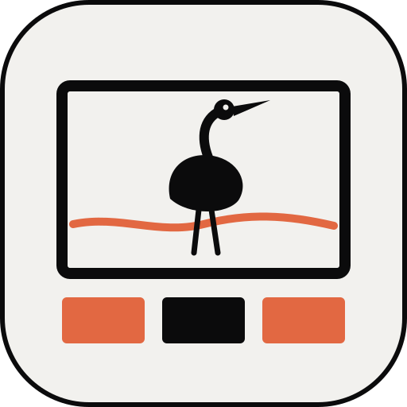
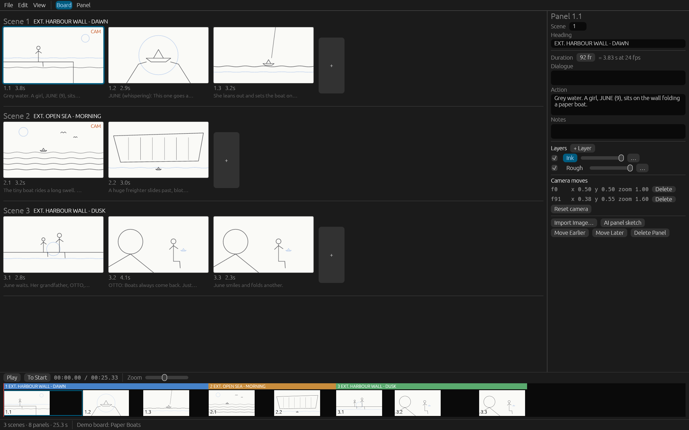

<p align="center">
  
</p>

<h1 align="center">BoardCraft</h1>

<p align="center"><b>Storyboards and animatics, in pure Rust.</b></p>

<p align="center">
BoardCraft is an open-source storyboarding and animatic app, one of the Crafting Apps. Board a
script into scenes and panels, sketch each panel with a pressure-aware brush, frame camera moves,
time the panels and play the animatic, then send the cut to FilmCraft.
</p>

<p align="center">
  
  
  
  
</p>

> [!NOTE]
> BoardCraft is a skeleton proposed to the ArtCraft team as the storyboarding step of the suite's
> film pipeline: **ScriptCraft** (screenplay) → **BoardCraft** (storyboards, animatic) →
> **FilmCraft** (edit). It is pre-alpha: the document model, file format and pipeline hand-offs
> work and are tested; the drawing tools are deliberately minimal.



[What works today](#what-works-today) · [Getting started](#getting-started) · [Pipeline](#pipeline) · [Downloads](#downloads) ·
[Roadmap](#roadmap) · [The Crafting Apps](#the-crafting-apps) · [License and credits](#license-and-credits)

## What works today

- **Your work is safe.** Autosave every 30 seconds, crash recovery at the next start, undo and
  redo for every edit (strokes, text, structure, settings), atomic saves.

- **Scenes and panels.** A board is scenes (number, heading) holding panels. Add, delete and reorder
  panels (across scene boundaries too).
- **Drawing.** Round brush with soft edge, size, colour and opacity; pen pressure (from tablets
  that report it) can drive size and opacity; eraser; Shift-click straight lines; layers with
  visibility and opacity; image import; canvas zoom, pan and rotation (the view only; drawing
  follows the rotated pointer); onion skin of the previous panel; **Pen Settings** with a pressure
  curve (previewed), minimum line size and a stabilizer (0–10) kept as your preferences;
  **Lasso** and **Rectangle select** to move, scale and rotate part of a layer by dragging the
  selection and its handles, with the arrow keys or with typed values (Enter applies, Esc cancels),
  plus cut, copy, paste and delete; **Fill** with tolerance, gap closing and sampling of the layer or
  all visible layers. Every drawing tool is one undo step. **Edit in Image Editor** sends a layer to GIMP, Krita, Photoshop or any editor and reloads it
  when you save there.
- **Board Settings.** Change the frame size and aspect ratio (16:9, 1.85, 2.39, 4:3, 1:1, 9:16,
  4:5) and the frame rate (23.976 to 60 fps) at any time, without stretching drawings or losing
  timing.
- **Panel text.** Shot type (with presets), dialogue, action and notes per panel; duplicate panels.
- **Timing.** Each panel has a duration in frames; drag a panel's edge on the timeline to retime it.
- **Camera.** Pan and zoom keyframes per panel (start and end), eased, edited by dragging and
  scrolling in the Panel view; the camera frames are drawn over the drawing.
- **Views.** Board view (thumbnail grid grouped by scene), Panel view (canvas, tools, camera), and
  a timeline strip with scene bands, thumbnails and a playhead.
- **Animatic playback.** Plays the panels for their durations at the project rate through each
  panel's camera move, with the dialogue as a caption, and the sound track through your speakers.
- **Audio track.** File ▸ Import Audio adds WAV, AIFF, MP3, AAC/M4A, FLAC, Ogg Vorbis or Opus
  (decoded by craft-audio) under the animatic with a waveform; clips mix, have trim and gain, and
  are anchored to a panel so they stay in sync when you retime. Drag a clip, nudge it with the
  arrow keys, or type its start.
- **Movie export.** File ▸ Export Movie writes an MP4 (H.264 and AAC, pure Rust through
  craft-video, craft-audio and craft-media) at board or half size, camera moves applied, with
  optional burn-ins: panel number, timecode and dialogue. It runs in the background with progress
  and Cancel.
- **Screenplay import.** Fountain, Final Draft (`.fdx`) and ScriptCraft's scene list (JSON) become
  scenes and panels with text and an estimated duration.
- **Re-import by scene id.** Importing a revised script updates the board in place: scenes matched
  by their stable id keep their drawings, cameras and timing and take the new text; new scenes are
  added, removed ones kept and reported.
- **Timeline export.** The animatic as OpenTimelineIO, CMX 3600 EDL, Final Cut Pro 7 XML or FCPXML,
  with rendered panel stills, the sound clips on audio tracks and scene markers (through craft-timeline). All four verified with
  FilmCraft's own importers.
- **Conform.** Read an editor's cut back (any of the four) and take its panel timing; optionally
  also its panel order and a note on panels it leaves out, after a summary of what changes.
- **Board sheets.** Printable PDF pages (A4 or Letter, any grid up to 6×6) with each panel's
  picture, number, duration, scene heading and the fields you choose (shot, dialogue, action,
  notes), an optional header line and ruled lines for handwritten notes, as selectable text
  (craft-pdf).
- **Keyboard shortcuts.** Every shortcut can be changed in Edit ▸ Keyboard Shortcuts… (the shared
  craft-keymap dialog); menus show the current keys and changes are kept per user.
- **Shot list.** CSV with scene, panel, shot, start timecode, duration and text.
- **Panel images.** Export every panel as a PNG.
- **Open project format.** `.boardcraft` is a ZIP of `project.json` plus one PNG per layer and the sound files,
  documented in [docs/file-format.md](docs/file-format.md). Saves are atomic.

- **Commands, CLI and MCP.** Every board edit is a command; `boardcraft-cli` runs them headless and
  exports, for scripts and agents ([docs/cli.md](docs/cli.md)), and `boardcraft-cli mcp` serves a
  board to MCP clients ([docs/mcp.md](docs/mcp.md)).
- **Accessible.** Every control has an AccessKit name; panels, timeline blocks and the canvas
  publish nodes; every drag has a keyboard or typed alternative; checked by kittest tests.
- **Languages.** Interface text goes through craft-i18n; translations arrive with
  `CRAFT_I18N_DIR` (English until BoardCraft's catalog exists).

Stubbed: **AI panel sketch** declares its role to the shared Craft AI layer and builds the prompt,
but does not call a model yet ([docs/gaps.md](docs/gaps.md)).


## Getting started

You need Rust 1.95 or newer (`rustup`).

```bash
cargo run --release -p boardcraft -- --demo          # the demo board
cargo run --release -p boardcraft -- script.fountain # board a screenplay
cargo run --release -p boardcraft -- my.boardcraft   # open a project
```

| Keys | |
|---|---|
| Space | play / pause the animatic |
| ← → | previous / next panel (moves keyboard focus to it) |
| Enter | open the focused panel in the Panel view |
| , . / Home | playhead one frame back / forward / to the start |
| V | Board view ↔ Panel view |
| B / E / C | brush / eraser / camera tool |
| L / M / G | lasso / rectangle select / fill tool |
| [ ] | smaller / larger brush |
| Ctrl+A | select the whole layer |
| ← → ↑ ↓ (Shift: 10 px) | with a selection: move it |
| Enter / Esc | with a selection: apply / cancel the move, scale or rotation |
| Ctrl+X, Ctrl+C, Ctrl+V, Delete | cut, copy, paste, delete the selection |
| Shift+[ Shift+] / Shift+0 | rotate the view 15° left / right, reset it |
| R+drag | rotate the view freely |
| Ctrl+S, Ctrl+Shift+S, Ctrl+O | save, save as, open |
| Ctrl+Z, Ctrl+Shift+Z | undo / redo (every edit) |
| Ctrl+N / Ctrl+D | new panel / duplicate panel after the selected one |
| Ctrl+, | Board Settings |
| O | onion skin |
| Ctrl+wheel, + / −, 0 | zoom the canvas, fit it |
| middle-drag, Alt+drag | pan the canvas |
| Shift+click | straight line from the end of the last stroke |

Optional build inputs (never Cargo dependencies), as in the other Craft apps:

```bash
CRAFT_I18N_DIR=$PWD/../craft-i18n CRAFT_FONTS_DIR=$PWD/../craft-fonts cargo run --release -p boardcraft
```

Headless:

```bash
cargo run -p boardcraft-cli -- new board.boardcraft --from script.fountain
```

Checks before every commit:

```bash
cargo xtask ci     # fmt, clippy -D warnings, tests, layering, assets, licences, progress fragments
```

## Pipeline

- **In: ScriptCraft (or any screenwriting app).** File ▸ Import Screenplay reads Fountain, Final
  Draft or ScriptCraft's scene list; on a board with work it updates scenes by their stable id.
- **Out: FilmCraft (or any editor).** File ▸ Export Animatic Timeline ▸ OTIO / EDL / FCP7 XML /
  FCPXML writes the timeline and `<name>_stills/`. File ▸ Conform Timing from Edit brings the
  editor's timing back.

Details: [docs/interop.md](docs/interop.md).

## Downloads

None yet: BoardCraft has not had a release. Packages will be named
`boardcraft-<version>-<platform>-<arch>.<ext>` (Linux tar.gz/deb/rpm from `packaging/linux/package.sh`).

## Roadmap

Stage and plans are in [ROADMAP.md](ROADMAP.md); the ranked work list is [docs/gaps.md](docs/gaps.md).

## The Crafting Apps

| | App | What it's for | Code |
|---|---|---|---|
| | ScriptCraft | Screenwriting | storytold/scriptcraft (proposed) |
| | **BoardCraft** | Storyboards and animatics | this repository |
| | FilmCraft | Video editing | [storytold/filmcraft](https://github.com/storytold/filmcraft) |
| | AniCraft | 2D vector animation | [storytold/anicraft](https://github.com/storytold/anicraft) |
| | PhotoCraft | Photo editing | [storytold/photocraft](https://github.com/storytold/photocraft) |

## License and credits

BoardCraft is licensed under either of the [Apache License, Version 2.0](LICENSE-APACHE) or the
[MIT license](LICENSE-MIT), at your option. Assets and their licences are listed in
[ATTRIBUTION.md](ATTRIBUTION.md); see also [NOTICE](NOTICE). Built on the shared Craft libraries
([storytold/craft-libs](https://github.com/storytold/craft-libs)) and egui.
